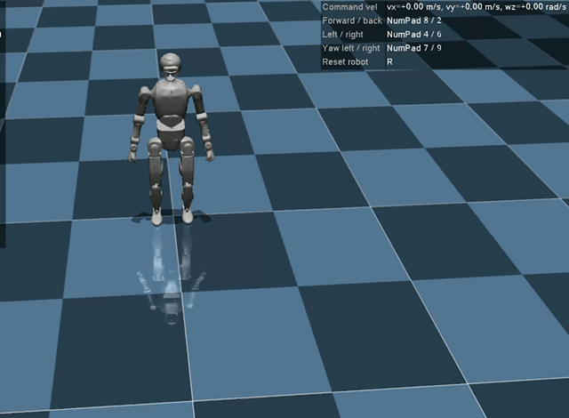
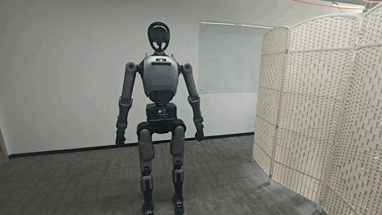

# Dex-Waddle · Dex 小步行走部署与使用说明

**注意：请仔细阅读 [DISCLAIMER.md](DISCLAIMER.md)。**

文档更新日期：2026-11-02

Dex-Waddle 是独立发布的天工行者 Dex 小步／慢速行走功能包，提供 **xMIGCS 运控安装包**、回滚包和 GIF 演示动图。

**注意：** 本说明仅提供安装包、回滚包和 GIF 演示动图，不包含模型训练源码、训练数据及完整训练过程。本包已完成真机验证，测试时请务必使用吊架。

## 效果预览

以下 GIF 为完整时长的循环预览。

### MuJoCo 仿真



### 真机行走



## 交付文件与版本

安装包请从 [GitHub Release](https://github.com/luckylhf/Dex-Waddle/releases/tag/v26.7.4.post4) 下载，再按下文步骤拷贝到本体板安装。

| 文件 | 用途 |
| --- | --- |
| [xmigcs-26.7.4.post4-cp312-cp312-linux_x86_64.whl](https://github.com/luckylhf/Dex-Waddle/releases/download/v26.7.4.post4/xmigcs-26.7.4.post4-cp312-cp312-linux_x86_64.whl) | 小步行走更新包 |
| [xmigcs-26.7.4-cp312-cp312-linux_x86_64.whl](https://github.com/luckylhf/Dex-Waddle/releases/download/v26.7.4.post4/xmigcs-26.7.4-cp312-cp312-linux_x86_64.whl) | 原始版本，供回滚使用 |
| [mujocowalk.gif](mujocowalk.gif) | MuJoCo 循环预览 |
| [realwallk.gif](realwallk.gif) | 真机行走循环预览 |

对应的 **Dex 系统版本为 `26.7.5.1`**，可在机器人 `192.168.41.1` 的版本页面核对。系统版本与 Python 运控包版本 `26.7.4.post4` 是不同版本号；安装 wheel 不代表完成整个机器人系统升级。

## 环境要求

- 安装目标：运行 xMIGCS 的机器人本体板。地址为 `192.168.41.1`，以现场网络配置为准。
- wheel 平台：**Linux x86_64、CPython 3.12**（`cp312-cp312-linux_x86_64`）；Python `>=3.12,<3.13`。

## 安装、生效与回滚

在机器人停止运动并有可靠支撑后，将 wheel 拷贝到本体板。以下命令在 wheel 所在目录执行，`python3.12` 代表运控服务实际使用的 Python 3.12 解释器。

**不要使用 `sudo pip` 或 `sudo python3.12 -m pip`。** 此为安装要求，使用本体运控对应的用户执行安装，避免装入与运控服务不一致的用户或 Python 环境，导致服务仍加载旧包或无法加载。安装与回滚均需保持用户和解释器环境一致。

### 安装更新包

```bash
# 安装前记录当前版本和安装位置
python3.12 --version
python3.12 -m pip show xmigcs

# 安装随包提供的 post4 版本
python3.12 -m pip install ./xmigcs-26.7.4.post4-cp312-cp312-linux_x86_64.whl --break-system-packages

# 核对 Version 为 26.7.4.post4，Location 属于运控服务使用的环境
python3.12 -m pip show xmigcs
python3.12 -m pip check
```

安装后**关机重启生效**。重启后检查本体运控服务是否正常启动，并再次核对版本。`pip show` 只能证明该解释器环境中的安装情况，还需通过实际启动环境及日志确认服务加载了更新后的包与模型。

### 回滚到随包原始版本

```bash
python3.12 -m pip install ./xmigcs-26.7.4-cp312-cp312-linux_x86_64.whl --break-system-packages

# 核对 Version 为 26.7.4
python3.12 -m pip show xmigcs
python3.12 -m pip check
```

回滚后同样关机重启并核验服务。此操作仅回滚 `xmigcs` 包，不回滚整个 Dex 系统、其他依赖或本体配置。

## 小步行走 话题控制

### 适用策略

速度控制话题在**半身行走／全身行走／站走跑一体**策略下有效。

### 速度控制接口

| 项目 | 内容 |
| --- | --- |
| 话题 | `/hric/robot/cmd_vel` |
| 消息类型 | `geometry_msgs/msg/TwistStamped` |
| `linear.x` | 前后速度指令，单位 m/s |
| `linear.y` | 侧移速度指令，单位 m/s |
| `angular.z` | 转向速度指令，单位 rad/s |
| 其余速度字段 | 保持 `0` |


### 速度参数

速度取值范围沿用原发布说明：

| 速度字段 | 单位 | 全身行走 | 半身行走 | 站走跑 |
| --- | --- | --- | --- | --- |
| `linear.x`（前后） | m/s | `[-0.8, 1.0]` | `[-0.8, 1.0]` | `[-0.5, 2.2]` |
| `linear.y`（侧移） | m/s | `[-0.5, 0.5]` | `[-0.5, 0.5]` | `[-0.5, 0.5]` |
| `angular.z`（转向） | rad/s | `[-0.8, 0.8]` | `[-0.8, 0.8]` | `[-1.0, 1.0]` |

### 速度状态划分

`vx`、`vy`、`wz` 分别对应 `linear.x`、`linear.y`、`angular.z`：

- 三个速度值的范数小于 `0.05` 时，机器人保持站立状态。
- `0.05 <= max(|vx|, |vy|, |wz|) && min(|vx|, |vy|, |wz|) <= 0.3`：慢速行走。

### 发布示例

以下示例**只发布零速度指令**。`20 Hz` 是示例发布频率，不是策略推理或底层电机控制频率。

```bash
ros2 topic pub -r 20 /hric/robot/cmd_vel geometry_msgs/msg/TwistStamped "header:
  stamp: now
  frame_id: 'pelvis'
twist:
  linear:
    x: 0.0
    y: 0.0
    z: 0.0
  angular:
    x: 0.0
    y: 0.0
    z: 0.0"
```

结束运动指令时，应先发送零速度并观察响应，必要时通过 `c` 切入 STOP。**停止发布或按终端 `Ctrl+C` 只会结束发布进程，不代表机器人已停止。** 当前材料未确认命令超时、断流归零、减速过程及重连后旧指令是否恢复；这些行为需在吊架测试中单独核验。

## 免责声明

1. 本包按“现状”提供。已完成的真机验证结果对应测试时的硬件、软件版本及运行环境，不构成对所有机器人个体、部署环境或使用场景的性能与安全保证。使用者应确认软硬件兼容性，遵守机器人操作规程，在吊架支撑、人员安全隔离及停止措施可用的条件下开展测试，并根据现场情况决定是否继续运行。

2. 使用者应自行评估安装、修改、部署及运行本包的风险。在适用法律允许的范围内，本包提供方不对因使用本包而造成的人身伤害、设备损坏、数据丢失及其他损失承担责任。

3. 修改 `192.168.41.1` 本体主机上的内容前，需向渠道方获取登录密码。进行此类修改即意味着放弃正常保修权益，请在充分了解相关影响后，审慎决定是否安装和使用本包。
